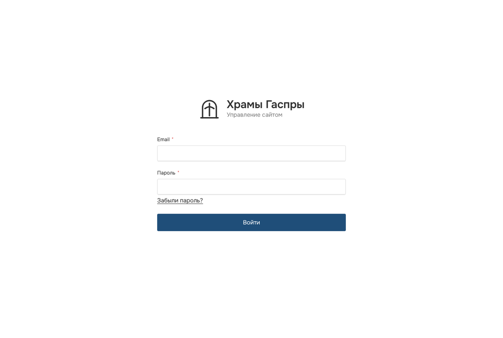
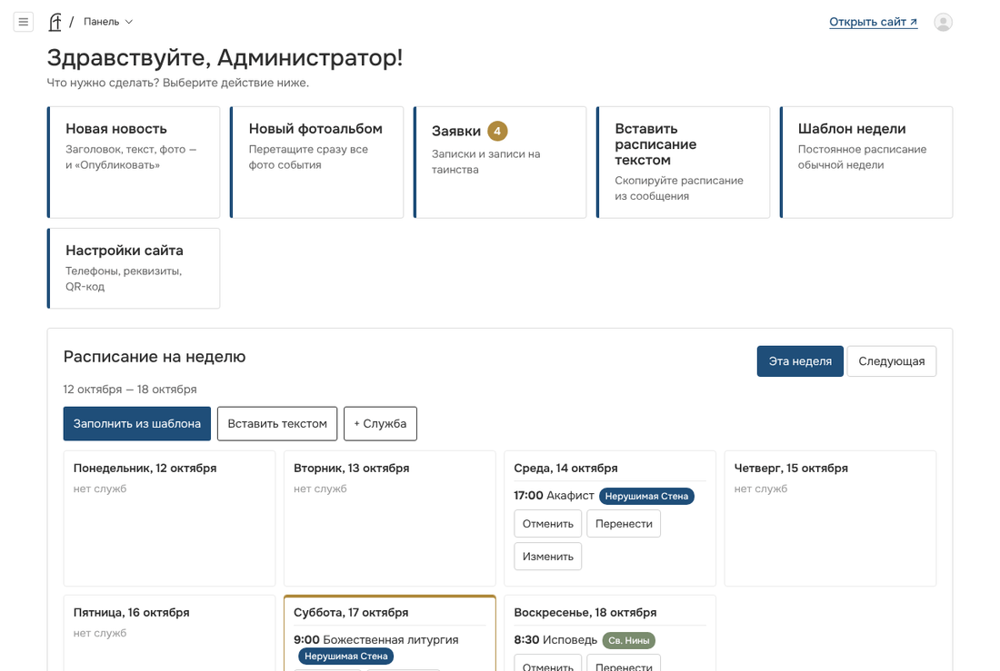
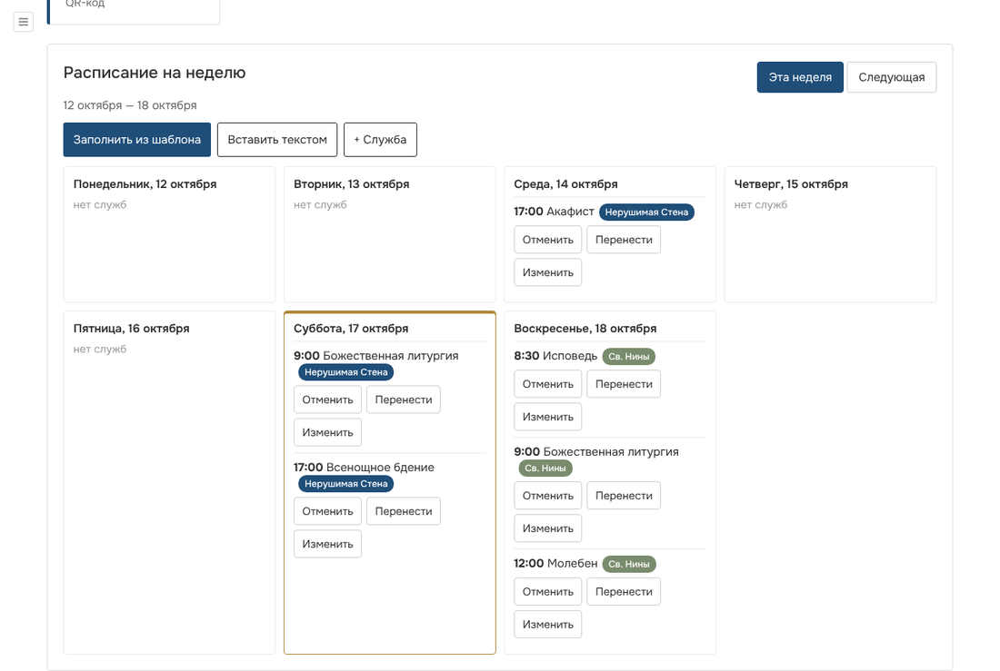
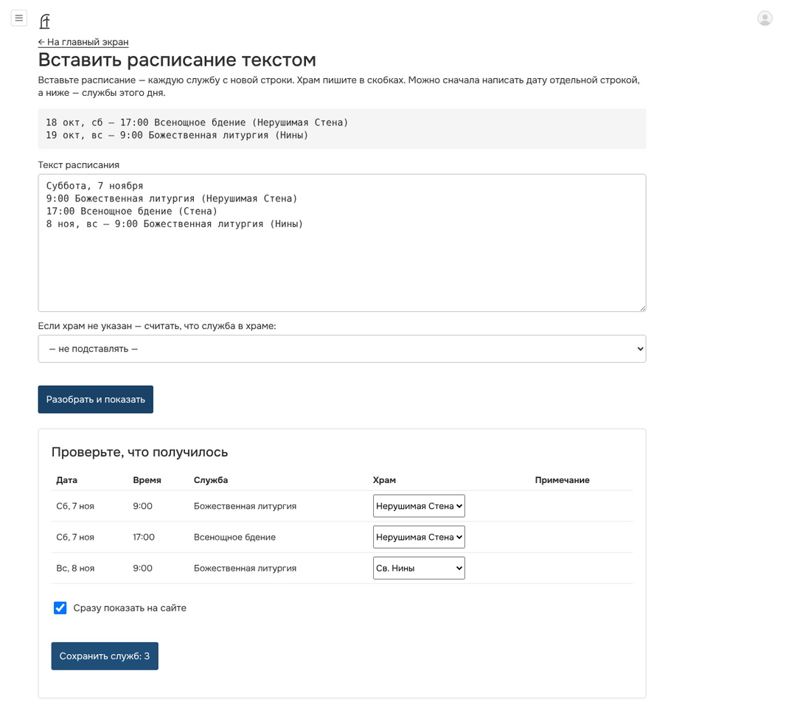
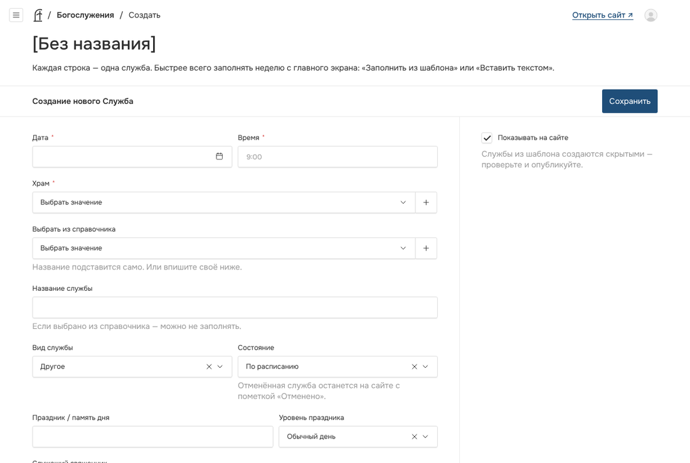
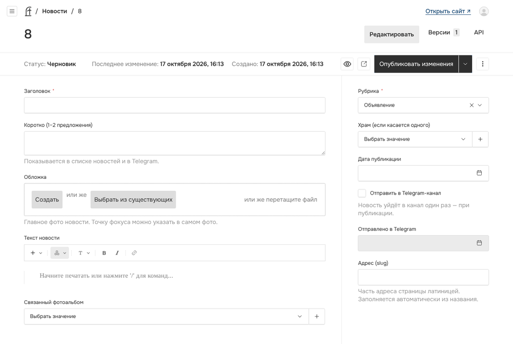
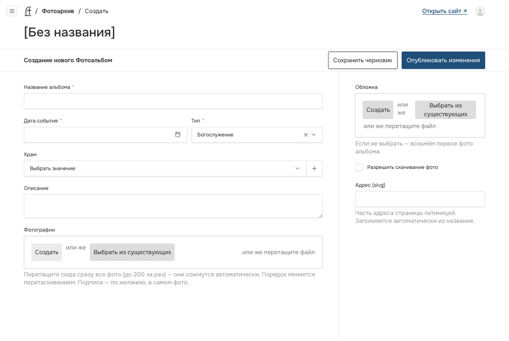
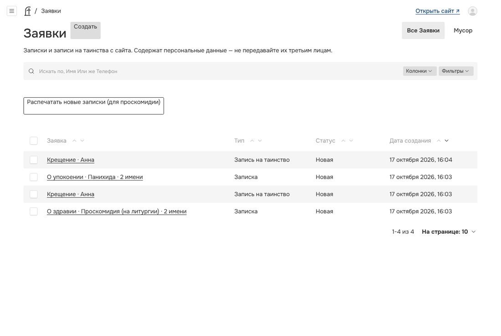
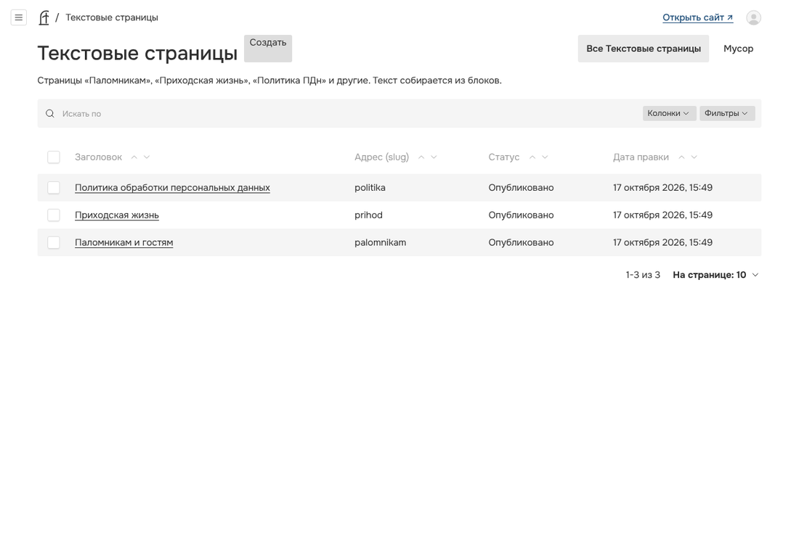
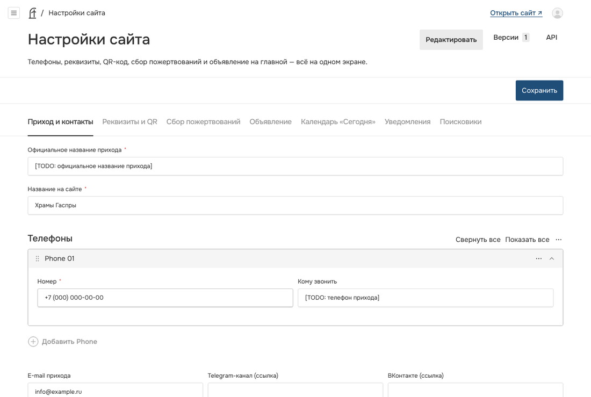

# Как работать с сайтом храмов Гаспры

Инструкция для настоятеля, старосты и волонтёров. Специальных знаний не нужно: всё делается мышкой или пальцем на телефоне.

**Адрес управления сайтом:** `адрес-сайта/admin` (например, `hramygaspry.ru/admin`).

---

## 1. Вход



1. Откройте адрес управления сайтом.
2. Введите свою почту и пароль. Пароль выдаёт администратор.
3. Нажмите **«Войти»**.

> Если забыли пароль — нажмите **«Забыли пароль?»**, на почту придёт ссылка.
> После пяти неверных попыток вход блокируется на 15 минут. Это защита от взлома. Подождите и попробуйте снова.

---

## 2. Главный экран



После входа вы видите крупные кнопки-действия:

| Кнопка | Что делает |
|---|---|
| **Новая новость** | Написать новость или объявление |
| **Новый фотоальбом** | Загрузить фотографии события |
| **Заявки** | Записки и записи на таинства с сайта. Число — сколько новых |
| **Вставить расписание текстом** | Скопировать расписание из сообщения |
| **Шаблон недели** | Постоянное расписание «обычной недели» |
| **Настройки сайта** | Телефоны, реквизиты, QR-код |

Ниже — **расписание на неделю**, **объявление на сайте**, **сбор пожертвований** и **последние изменения** (кто и что менял).

Кнопка **«Открыть сайт ↗»** вверху справа открывает сайт в новой вкладке.

> Какие кнопки вы видите, зависит от роли. Редактор не видит заявки и настройки, священник — новости и альбомы.

---

## 3. Внести расписание на неделю (≈ 5 минут)



**Способ 1. Из шаблона — когда неделя обычная.**

1. На главном экране в блоке «Расписание на неделю» нажмите **«Следующая»**.
2. Нажмите **«Заполнить из шаблона»**. Появятся службы обычной недели с пометкой **«скрыта»** — на сайте их пока не видно.
3. Поправьте, что отличается: праздник, другое время, другой храм — кнопка **«Изменить»** у службы.
4. Нажмите **«Опубликовать неделю»**. Готово — службы на сайте.

**Способ 2. Вставить текстом — когда расписание уже написано в сообщении.**



1. Нажмите **«Вставить текстом»**.
2. Вставьте расписание. Каждая служба — с новой строки, храм — в скобках:
   ```
   18 окт, сб — 17:00 Всенощное бдение (Нерушимая Стена)
   19 окт, вс — 9:00 Божественная литургия (Нины)
   ```
   Можно и так — дата отдельной строкой, ниже службы этого дня:
   ```
   Суббота, 7 ноября
   9:00 Божественная литургия (Стена)
   17:00 Всенощное бдение (Стена)
   ```
3. Нажмите **«Разобрать и показать»**. Проверьте таблицу:
   - **красным** — строки, которые не удалось понять. Исправьте текст и нажмите «Разобрать» ещё раз;
   - **жёлтым** — подсказки, например: «В строке указано вс, но 19.10 — понедельник».
4. Если храм не определился — выберите его в таблице.
5. Нажмите **«Сохранить служб: N»**.

**Способ 3. Одна служба вручную** — кнопка **«+ Служба»**.



Выберите дату, впишите время (`9:00`), храм и название из **справочника** — тогда название и вид службы подставятся сами. Поле «Примечание» — для пометок вроде «Исповедь с 8:30».

> Постоянное расписание обычной недели настраивается в разделе **«Шаблон недели»**. Менять его нужно, только если расписание прихода изменилось насовсем.
> Если расписание на следующую неделю не внесено, в понедельник в 10:00 бот пришлёт напоминание в Telegram.

---

## 4. Отменить или перенести службу (2 нажатия)

На главном экране в расписании недели у каждой службы есть кнопки:

- **«Отменить»** — служба останется на сайте зачёркнутой, с пометкой «Отменено». Передумали — **«Вернуть»**.
- **«Перенести»** — впишите новое время и нажмите **«Сохранить»**. На сайте появится пометка «Новое время» и «Перенесено с …».

---

## 5. Опубликовать новость с фото



1. Главный экран → **«Новая новость»**.
2. **Заголовок** и **«Коротко»** — одно-два предложения, их видно в списке новостей и в Telegram.
3. **Обложка** — нажмите «Создать» или перетащите фото. Обязательно опишите, что на фото («Крестный ход у храма святой Нины»).
4. **Текст новости.** Панель над текстом: заголовок, **жирный**, *курсив*, ссылка, список, цитата. Чтобы вставить фото, галерею или видео из VK/Rutube — нажмите **«+»** в начале пустой строки.
5. Справа выберите **рубрику** (Объявление, Событие, Проповедь, Приход) и, если нужно, **храм**.
6. Поставьте галочку **«Отправить в Telegram-канал»**, если новость нужно разослать.
7. Нажмите **«Опубликовать изменения»**.

**Полезно знать:**
- Черновик **сохраняется сам** каждые пару секунд. Можно закрыть страницу и вернуться позже.
- Значок «глаз» — **предпросмотр**: так новость будет выглядеть на сайте, до публикации.
- **Отложенная публикация:** стрелка рядом с кнопкой «Опубликовать» → «Запланировать публикацию» → выберите дату и время.
- **Вернуть прошлый вариант:** вкладка **«Версии»** вверху → выберите версию → «Восстановить».

---

## 6. Загрузить фотоальбом



1. Главный экран → **«Новый фотоальбом»**.
2. Название, дата события, тип (Богослужение, Праздник, История храма, Приход, Исторические фото), храм.
3. В поле **«Фотографии»** перетащите **сразу все фото** — можно до 200 за раз. Сайт сам их уменьшит, чтобы страницы открывались быстро.
4. Порядок фото меняется перетаскиванием. Подписи — по желанию.
5. Обложка — если не выбрать, возьмётся первое фото.
6. **«Разрешить скачивание»** — посетители смогут скачать фото в полном размере.
7. Нажмите **«Опубликовать»**.

---

## 7. Обработать записку



1. Главный экран → **«Заявки»** (число на кнопке — сколько новых).
2. Чтобы распечатать **все новые записки** для проскомидии — кнопка **«Распечатать новые записки»** над списком. Имена сгруппированы: «О здравии — Проскомидия», «О упокоении — Панихида» и т. д.
3. Откройте заявку, поменяйте **статус** на **«Выполнена»** и нажмите **«Сохранить»**.

> Заявки содержат персональные данные. Не пересылайте их и не публикуйте.
> О каждой новой заявке приходит письмо и сообщение в Telegram ответственному (настраивается в «Настройках сайта» → «Уведомления»).

---

## 8. Поменять текст на странице



Страницы «Паломникам», «Приходская жизнь», «Политика ПДн» — в разделе **«Текстовые страницы»**. Страница собирается из **блоков**: текст, карточки, шаги «как добраться», вопросы-ответы, фото, карта, контакты.

1. Откройте страницу.
2. Измените текст в нужном блоке. Блоки можно добавлять, удалять и перетаскивать.
3. Нажмите **«Опубликовать изменения»**.

Страницы храмов — в разделе **«Храмы»**, духовенство — **«Духовенство»**, таинства — **«Таинства и требы»**.

---

## 9. Поменять телефон, реквизиты, QR-код



Всё на одном экране: **«Настройки сайта»**. Вкладки сверху:

- **Приход и контакты** — название, телефоны, почта, соцсети, часы работы.
- **Реквизиты и QR** — банковские реквизиты, картинка QR-кода СБП.
- **Сбор пожертвований** — цель, сколько нужно и сколько собрано (это же можно поменять прямо на главном экране).
- **Объявление** — полоса вверху сайта («19 октября литургия в 8:00»). Можно задать, до какого числа показывать.
- **Календарь «Сегодня»** — память святых на день (дата по старому стилю, седмица и посты считаются сами).
- **Уведомления** — кому присылать заявки.

Нажмите **«Сохранить»**.

---

## 10. Если что-то пошло не так

- **Удалили по ошибке?** Новости, альбомы, страницы и заявки сначала попадают в **корзину** и хранятся 30 дней. Откройте раздел → «Корзина» → «Восстановить».
- **Не удаляется фото?** Оно используется в новости, альбоме или на странице храма. Сначала уберите его оттуда.
- **Сайт не обновился?** Обновите страницу сайта через минуту.
- **Кто что поменял** — «Последние изменения» на главном экране или раздел «Журнал действий».

Вопросы — администратору сайта: `[TODO: контакт администратора]`.
